# ⚡ Infinite LLM Auto-Fallback Router + 9Router Patch Kit (v2.0)

<p align="center">
  <a href="https://jashory.github.io/infinite-llm-fallback-router/"></a>
  <a href="https://github.com/jashory/infinite-llm-fallback-router/releases/tag/v2.0.0"></a>
  <a href="https://github.com/jashory/infinite-llm-fallback-router/blob/main/action.yml"></a>
</p>

<p align="center">
  
</p>


**Never stop coding on HTTP 429 quota walls again. Chain OpenAI, Anthropic (`/v1/messages`), Gemini, Groq, and OpenRouter into one uninterrupted SSE streaming local endpoint.**

Built by **HM Shihabuddin Jashory (Shihab)** — [Vision Flow](https://visionflowgroup.com)

---

## ⚡ 1. Install via AI Agent (Claude Code, Antigravity, Cursor, Codex)
Paste this single prompt into your AI coding agent:
> **Prompt:** `Clone https://github.com/jashory/infinite-llm-fallback-router and run "python install.py" to install the local LLM fallback router and Agent Skill.`

## 💻 2. Install via CLI (Terminal / Skills CLI / pip)
```bash
# Option A: Agent Skills CLI
npx skills add jashory/infinite-llm-fallback-router

# Option B: Direct Git Clone + 1-Command Installer
git clone https://github.com/jashory/infinite-llm-fallback-router.git
cd infinite-llm-fallback-router && python install.py

# Option C: Global CLI Tool via pip / uv
pip install git+https://github.com/jashory/infinite-llm-fallback-router.git
llm-fallback-router --port 20128
```

---

## 🔥 Features

1. **Multi-Threaded SSE Streaming & Non-Streaming Proxy (`llm_fallback_router.py`)**:
   - Zero external dependencies (100% Python Standard Library).
   - Supports both `stream: true` (`text/event-stream`) and standard JSON responses.
   - Automatic failover on `HTTP 429`, `500`, `502`, `503`, `504`, `529`, or connection timeouts with configurable per-provider cooldown timers.
2. **Built-In Anthropic `/v1/messages` <-> OpenAI `/v1/chat/completions` Bridge**:
   - Point **Claude Code** (`ANTHROPIC_BASE_URL=http://127.0.0.1:20128`) directly at the router and seamlessly fail over to OpenAI/Gemini/Groq/OpenRouter providers when Anthropic quota runs out.
3. **Production `9Router` Custom Patch Modules (`9router-patches/`)**:
   - Includes `ag-model-routing.cjs` and `quota-normalization.cjs` for advanced `9Router` setups.

## GitHub Actions Integration (`action.yml`)

Use `infinite-llm-fallback-router` directly inside any CI/CD workflow:

```yaml
- name: Run infinite-llm-fallback-router
  uses: jashory/infinite-llm-fallback-router@v2.0.0
```

## Live Interactive Browser Playground

Test payloads directly in your browser (100% client-side, zero installation required):
**[https://jashory.github.io/infinite-llm-fallback-router/](https://jashory.github.io/infinite-llm-fallback-router/)**
